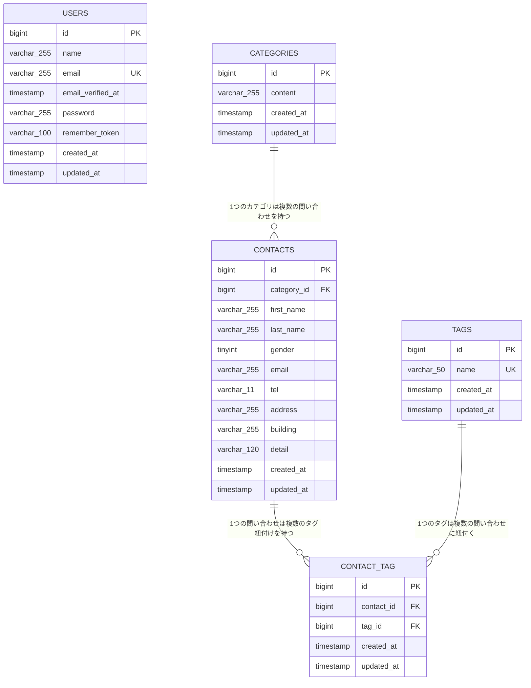

# COACHTECH お問い合わせフォーム

COACHTECH「基礎学習ターム 確認テスト」の提出物です。お問い合わせフォーム(公開フォーム)・管理画面(一覧検索・詳細・タグ管理・CSVエクスポート)・認証不要の公開REST APIを備えた、Laravel製のお問い合わせ管理システムです。

## 概要

- 一般ユーザー向けに、氏名・性別・メールアドレス・電話番号・住所・お問い合わせの種類・タグ・お問い合わせ内容を入力する公開フォーム(`/`)を提供する。入力内容は確認画面(`/contacts/confirm`)を経てDBに保存し、サンクスページ(`/thanks`)へ遷移する。
- 管理者はFortifyによるセッション認証でログインし、管理画面(`/admin`)でお問い合わせの一覧検索・ページネーション・詳細閲覧・削除、タグの追加・編集・削除ができる。検索条件を指定してBOM付きCSVとしてエクスポートすることもできる(`/contacts/export`)。
- 認証不要の公開REST API(`/api/v1/contacts`)を提供し、お問い合わせデータの一覧取得(検索・ページング付き)・詳細取得・作成・更新・削除をJSONで行える。

## ER図



`CONTACTS` と `TAGS` は `CONTACT_TAG` を介した多対多の関係(1つの問い合わせに複数タグ、1つのタグが複数の問い合わせに付く)。`USERS`(管理者アカウント)は他テーブルと外部キー関係を持たない。

## 環境構築手順

前提: Docker・Docker Composeがインストールされていること。

```bash
# 1. リポジトリを取得し、依存パッケージをインストール
git clone <このリポジトリのURL>
cd contact-form-app
composer install

# 2. .env を用意する(.env.example をコピーし、DB_HOST=mysql になっていることを確認)
cp .env.example .env

# 3. Sailでコンテナを起動
sail up -d

# 4. アプリケーションキーを生成
sail artisan key:generate

# 5. フロントエンド依存パッケージをインストール
sail npm install

# 6. マイグレーション・初期データ投入
sail artisan migrate --seed
```

`.env` の `DB_HOST` は `localhost`/`127.0.0.1` ではなく、Dockerのコンテナ名 `mysql` を指定すること。

既存DBをリセットしたい場合は以下を実行する。

```bash
sail artisan migrate:fresh --seed
```

### 日常の開発コマンド

```bash
sail up -d                            # コンテナ起動
sail artisan migrate:fresh --seed     # DBリセット+初期データ投入
sail npm run dev                      # Vite(Tailwind)開発サーバー

sail test                             # 全テスト実行
sail artisan test --coverage          # カバレッジ測定
sail artisan test --filter=TestName   # 単一テスト実行

vendor/bin/pint                       # コードフォーマット
```

### 初期データ(Seederで投入される内容)

| 内容 | 件数 | 備考 |
| --- | --- | --- |
| 管理者アカウント | 1件 | `test@example.com` / `password` |
| カテゴリ(`categories`) | 5件 | 商品のお届けについて / 商品の交換について / 商品トラブル / ショップへのお問い合わせ / その他 |
| タグ(`tags`) | 5件 | 質問 / 要望 / 不具合報告 / ご意見 / その他 |
| お問い合わせ(`contacts`) | 20件 | Faker(`ja_JP`)によるダミーデータ、各1〜3件のタグ付き |

## 使用技術

- PHP 8.2 / Laravel 10
- MySQL 8.0
- Laravel Sail(Docker)/ Nginx
- Laravel Fortify(管理者のログイン・登録認証)
- Blade / Tailwind CSS / Alpine.js(提供済みフロントエンド)
- PHPUnit(テスト)/ Laravel Pint(コードフォーマット)
- phpMyAdmin(DB管理UI)

## APIエンドポイント一覧

### 公開REST API(`/api/v1/*`、認証不要)

| Method | エンドポイント | 概要 |
| --- | --- | --- |
| GET | `/api/v1/contacts` | お問い合わせ一覧取得(`keyword`/`gender`/`category_id`/`date`/`per_page`で検索・ページング) |
| GET | `/api/v1/contacts/{contact}` | お問い合わせ詳細取得(カテゴリ・タグを含む) |
| POST | `/api/v1/contacts` | お問い合わせ新規作成 |
| PUT | `/api/v1/contacts/{contact}` | お問い合わせ更新 |
| DELETE | `/api/v1/contacts/{contact}` | お問い合わせ削除 |

### Web(セッション認証・Blade)

| Method | エンドポイント | 概要 |
| --- | --- | --- |
| GET | `/` | お問い合わせフォーム入力ページ |
| POST | `/contacts/confirm` | 入力内容のバリデーション・確認ページ表示 |
| POST | `/contacts` | お問い合わせ保存 |
| GET | `/thanks` | 送信完了ページ |
| GET | `/register` | 管理者登録ページ(Fortify) |
| GET | `/login` | ログインページ(Fortify) |
| GET | `/admin` | 管理画面 お問い合わせ一覧(要ログイン) |
| GET | `/admin/contacts/{contact}` | お問い合わせ詳細ページ(要ログイン) |
| DELETE | `/admin/contacts/{contact}` | お問い合わせ削除(要ログイン) |
| GET | `/contacts/export` | 検索条件に一致するお問い合わせをCSVダウンロード(要ログイン) |
| POST | `/admin/tags` | タグ新規作成(要ログイン) |
| GET | `/admin/tags/{tag}/edit` | タグ編集ページ(要ログイン) |
| PUT | `/admin/tags/{tag}` | タグ更新(要ログイン) |
| DELETE | `/admin/tags/{tag}` | タグ削除(要ログイン) |

## 開発環境URL

- アプリケーション: http://localhost
- phpMyAdmin: http://localhost:8080

## 作成者

mai-omi
