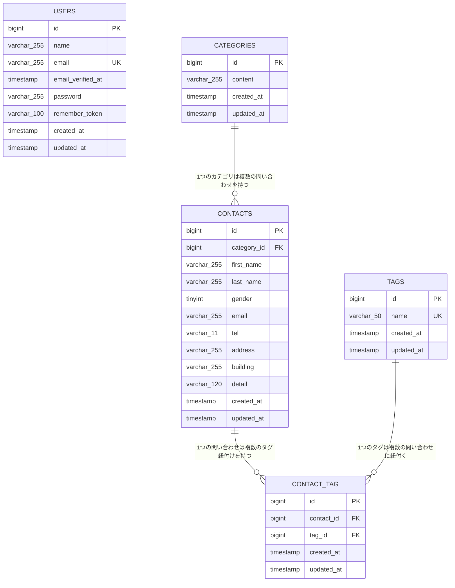

# Issue #1 設計書: DB設計・マイグレーション・モデル・Seeder実装

## 1. 概要

お問い合わせフォーム一式(入力・一覧・タグ付け)と管理者認証を支えるDBの土台を作る。`users`・`categories`・`contacts`・`tags`・`contact_tag`の5テーブルをマイグレーションで定義し、対応するEloquentモデルとリレーションを用意する。あわせて、画面の初期表示に必要な固定データ(管理者1件・カテゴリ5件・タグ5件)とダミーの問い合わせ20件をSeederで投入できるようにする。

この設計書はDB・モデル・Seederの範囲のみを扱う。ルーティング・コントローラー・画面・バリデーション・認証(Fortify)は別Issue(#2〜#8)の範囲で、ここでは対象外とする。

## 2. 受け入れ条件

Issue #1 本文は「ログインして`/admin`にアクセスできる」「`/`の選択肢に表示される」という"ブラウザで見える"完了条件を挙げているが、それらはルーティング・画面(#2, #5, #6)が実装されて初めて確認できる。本Issueの時点(ルーティング未実装)で確認できる形に読み替えると、以下の通りになる。

- `sail artisan migrate` を実行すると、エラーなく完了し、`users`・`categories`・`contacts`・`tags`・`contact_tag` の5テーブルがDBに作成される。
- phpMyAdmin(`http://localhost:8080`)で各テーブルの構造を開くと、「4. 増えるテーブル」に記載した列・型・制約(PRIMARY KEY / NOT NULL / UNIQUE / FOREIGN KEY / ON DELETE)と一致している。
- `sail artisan migrate --seed`(または`migrate:fresh --seed`)を実行すると、エラーなく完了し、`users`に1件・`categories`に5件・`tags`に5件・`contacts`に20件のレコードが投入される。
- `sail artisan tinker` で `User::where('email', 'test@example.com')->first()` を実行すると管理者ユーザーが取得でき、`Hash::check('password', $user->password)` が `true` になる(平文で保存されていないこと)。
- `sail artisan tinker` で `Contact::first()->category` と `Contact::first()->tags` を実行すると、それぞれ紐づく `Category` モデル・`Tag` モデルのコレクション(1〜3件)が取得できる。
- `sail artisan migrate:fresh --seed` を複数回実行しても、同じ件数・同じ固定データになる(再実行しても壊れない)。

「ログインして`/admin`に入れる」「`/`の選択肢に出る」という画面レベルの確認は、#2・#5・#6が完了した時点で改めて確認する(本Issueはその前提となるデータを用意するだけ)。

## 3. 変えないもの

- `resources/views/**` と `resources/js/contact/**` (提供済みBlade/JS。本Issueでは触らない)
- `compose.yaml` (Docker構成。Apple Silicon対応の`platform`行追加以外は変更しない)
- バージョン固定: PHP 8.2 / Laravel 10.x / MySQL 8.0(環境構築手順シート通り)
- 既存の `database/migrations/..._create_users_table.php` はusersテーブル仕様(下記)とすでに一致しているため、編集しない(新しいカラムの追加マイグレーションも不要)。
- `.env` のDB接続情報(`DB_HOST=mysql`など)

## 4. 増えるテーブル

### 4.1 列・型・制約

**users**(既存マイグレーションのまま。新規作成しない)

| 列 | 型 | 制約 |
|---|---|---|
| id | bigint unsigned | PRIMARY KEY, NOT NULL |
| name | varchar(255) | NOT NULL |
| email | varchar(255) | NOT NULL, UNIQUE |
| email_verified_at | timestamp | NULL許可 |
| password | varchar(255) | NOT NULL |
| remember_token | varchar(100) | NULL許可 |
| created_at / updated_at | timestamp | - |

**categories**(新規)

| 列 | 型 | 制約 |
|---|---|---|
| id | bigint unsigned | PRIMARY KEY, NOT NULL |
| content | varchar(255) | NOT NULL |
| created_at / updated_at | timestamp | - |

**contacts**(新規)

| 列 | 型 | 制約 |
|---|---|---|
| id | bigint unsigned | PRIMARY KEY, NOT NULL |
| category_id | bigint unsigned | NOT NULL, FOREIGN KEY → `categories.id`, ON DELETE CASCADE |
| first_name | varchar(255) | NOT NULL |
| last_name | varchar(255) | NOT NULL |
| gender | tinyint | NOT NULL(1=男性, 2=女性, 3=その他) |
| email | varchar(255) | NOT NULL(UNIQUE制約なし。同一メールで複数回の問い合わせを許容) |
| tel | varchar(11) | NOT NULL(10〜11桁・ハイフンなし) |
| address | varchar(255) | NOT NULL |
| building | varchar(255) | NULL許可 |
| detail | varchar(120) | NOT NULL |
| created_at / updated_at | timestamp | - |

**tags**(新規)

| 列 | 型 | 制約 |
|---|---|---|
| id | bigint unsigned | PRIMARY KEY, NOT NULL |
| name | varchar(50) | NOT NULL, UNIQUE |
| created_at / updated_at | timestamp | - |

**contact_tag**(新規・中間テーブル)

| 列 | 型 | 制約 |
|---|---|---|
| id | bigint unsigned | PRIMARY KEY, NOT NULL |
| contact_id | bigint unsigned | NOT NULL, FOREIGN KEY → `contacts.id`, ON DELETE CASCADE |
| tag_id | bigint unsigned | NOT NULL, FOREIGN KEY → `tags.id`, ON DELETE CASCADE |
| created_at / updated_at | timestamp | - |
| (複合制約) | - | UNIQUE(`contact_id`, `tag_id`) |

### 4.2 テーブル同士の関係とEloquentリレーション

- `categories` 1 : `contacts` 多 → `Category::contacts()` hasMany / `Contact::category()` belongsTo
- `contacts` 多 : `tags` 多(`contact_tag`経由) → `Contact::tags()` belongsToMany(`contact_tag`) / `Tag::contacts()` belongsToMany(`contact_tag`)
- `users` は他テーブルと外部キー関係を持たない(管理画面へのログイン用アカウントのみ)

### 4.3 ER図

`CONTACTS` と `TAGS` は `CONTACT_TAG` を介した多対多の関係(1つの問い合わせに複数タグ、1つのタグが複数の問い合わせに付く)。`USERS` は他テーブルと関係を持たないため、図中では独立したエンティティとして存在する。

### 4.4 Seederで入るデータ

| Seeder | 対象テーブル | 内容 |
|---|---|---|
| `UserSeeder` | users | 1件固定: name=`Test User`, email=`test@example.com`, password=`password`(`Hash::make()`でハッシュ化) |
| `CategorySeeder` | categories | 5件固定: 商品のお届けについて / 商品の交換について / 商品トラブル / ショップへのお問い合わせ / その他 |
| `TagSeeder` | tags | 5件固定: 質問 / 要望 / 不具合報告 / ご意見 / その他 |
| `ContactSeeder` | contacts, contact_tag | Faker(`ja_JP`)で20件。`category_id`は既存categoriesからランダム選択。各contactに既存tagsから1〜3件を`attach()`。生成する`tel`はバリデーションルール(10〜11桁・ハイフンなし)に適合する値にする |
| `DatabaseSeeder` | - | 上記を `UserSeeder → CategorySeeder → TagSeeder → ContactSeeder` の順で呼び出す |

## 5. 増える画面

なし(ルーティング・コントローラー・画面は Issue #2 以降の範囲)。

## 6. 入力チェックとメッセージ一覧

なし(フォーム・検索・タグ管理のバリデーションは Issue #2・#6・#8・#10 以降で扱う)。`tags.name` のUNIQUE制約や各FOREIGN KEYはDBレベルの整合性制約であり、ユーザー向けの入力チェック・エラーメッセージとは別。

## 7. テスト観点

- 各マイグレーションを実行した結果、テーブル定義(列・型・NOT NULL・UNIQUE・FOREIGN KEY)が「4.1 列・型・制約」と一致していること。
- 外部キーのON DELETE CASCADEが機能すること。
  - `categories` の1件を削除すると、それを参照している `contacts` も削除される。
  - `contacts` の1件を削除すると、紐づく `contact_tag` の行も削除される。
  - `tags` の1件を削除すると、紐づく `contact_tag` の行も削除される。
- `contact_tag` に同じ `contact_id`・`tag_id` の組み合わせを2回登録しようとするとUNIQUE制約違反になること。
- `Category::contacts()`・`Contact::category()`・`Contact::tags()`・`Tag::contacts()` の各リレーションが期待通りのモデル/コレクションを返すこと。
- Seeder実行後、`users`=1件・`categories`=5件・`tags`=5件・`contacts`=20件になっていること。
- `UserSeeder` で作成したユーザーのパスワードがハッシュ化されており、平文`password`とは一致しないが `Hash::check()` では一致すること。
- `ContactSeeder` で作成された各 `Contact` に1〜3件の `Tag` が紐づいていること。
- `migrate:fresh --seed` を複数回実行しても、同じ件数・同じ固定データ(カテゴリ5件・タグ5件の内容)になること(再実行可能性)。

## 8. 確認事項(いずれも回答済み)

1. Issue #1 本文の受け入れ条件(ログインして`/admin`に入れる・`/`の選択肢に表示される)は、ルーティング・画面(#2, #5, #6)が完了して初めてブラウザで確認できる。本設計書では「2. 受け入れ条件」の通り、Tinker/phpMyAdminでの確認に読み替えた。→**OK**
2. 中間テーブル名は要件シート・Laravelの慣例に従い単数形の `contact_tag` のままにする。命名規則シートの「DBテーブル名はsnake_case複数形」とは字面上一致しないが、テーブル仕様書の指定を優先する。→**OK**
3. `contacts.email` にUNIQUE制約を付けない(同一メールアドレスで複数回の問い合わせを許容する)。→**OK**
4. 既存の `password_reset_tokens`・`personal_access_tokens`(Sanctum用)・`failed_jobs` マイグレーションと `laravel/sanctum` パッケージは、本課題では未使用だが**削除せず、現状のまま残す**(最終判断)。
5. `ContactSeeder` が生成する `tel` は、Fakerの標準の電話番号フォーマットだとハイフンや国番号が付く場合があるため、バリデーションルール(10〜11桁・ハイフンなし)に適合する値を独自ロジックで生成する。→**OK**
6. README添付用のER図は、本設計書のMermaidをそのまま転記する想定(Issue #12)。→**OK**
