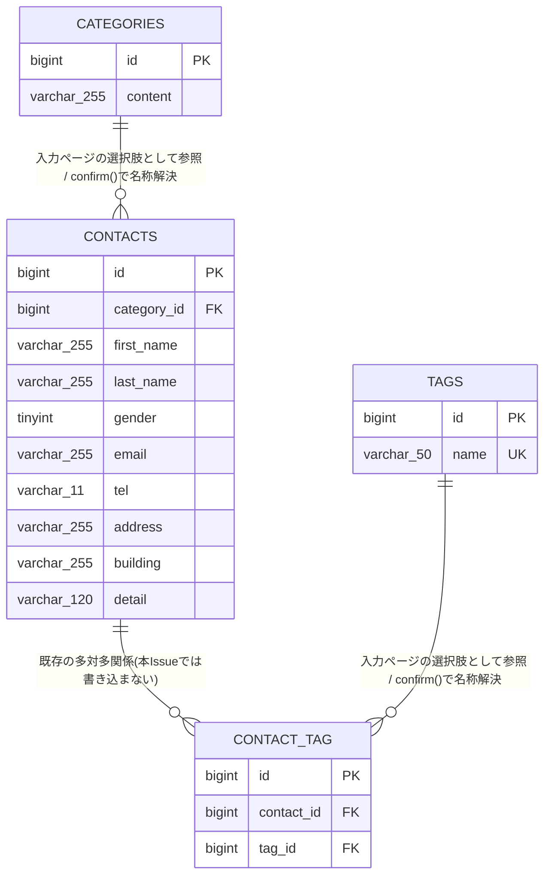

# Issue #2 設計書: お問い合わせ入力フォーム(PG01)とバリデーション実装

## 1. 概要

GET `/`(お問い合わせフォーム入力ページ、Blade提供済み)にルーティングとコントローラーを実装し、`categories`・`tags`をDBから取得して表示する。あわせて `StoreContactRequest` で入力チェックを行い、日本語エラーメッセージを表示する。バリデーション通過後は `ContactController@confirm` で確認ページ(`contact.confirm`)に入力内容・選択されたカテゴリ名・タグ名を表示する。

**本Issueのスコープに含まれないもの**: 確認ページの「送信」ボタンを押した後の実際のDB保存処理(`POST /contacts` → `ContactController@store`)はIssue #3の範囲であり、ここでは扱わない。

## 2. 受け入れ条件

- `GET /` にアクセスすると200が返り、姓・名・性別・メールアドレス・電話番号・住所・建物名・お問い合わせの種類・タグ・お問い合わせ内容の入力欄が表示される。
- 入力ページの「お問い合わせの種類」の選択肢に、`categories`テーブルの5件がドロップダウンとして表示される。
- 入力ページの「タグ」の選択肢に、`tags`テーブルの5件がチェックボックスとして表示される。
- 姓を空のまま「確認画面」ボタンを押すと、「姓を入力してください」というエラーメッセージが表示され、入力ページに留まる(確認ページには遷移しない)。
- 名・性別・メールアドレス・電話番号・住所・お問い合わせの種類・お問い合わせ内容をそれぞれ空のまま送信すると、要件シート記載の対応するエラーメッセージが表示される。
- メールアドレスにメール形式でない文字列(例: `test`)を入力すると、「メールアドレスはメール形式で入力してください」というエラーメッセージが表示される。
- お問い合わせ内容に121文字以上を入力すると、「お問い合わせ内容は120文字以内で入力してください」というエラーメッセージが表示される。
- 建物名を空のまま送信してもエラーにならない(任意項目)。
- フォーム改ざん等で存在しない`category_id`・存在しない`tag_id`を送信すると、バリデーションエラーになる。
- すべての必須項目を正しく入力して「確認画面」ボタンを押すと、`POST /contacts/confirm` のバリデーションを通過し、確認ページに入力した氏名・性別(文字列)・メールアドレス・電話番号・住所・建物名・お問い合わせの種類(カテゴリ名の文字列)・選択したタグ(文字列)・お問い合わせ内容が正しく表示される。

## 3. 変えないもの

- `resources/views/contact/index.blade.php`・`_form.blade.php`・`confirm.blade.php` と `resources/js/contact/**`(提供済み。変更しない)
- `database/migrations/**`・`app/Models/Category.php`・`Tag.php`・`Contact.php`・`database/seeders/**`(Issue #1で実装済み。本Issueでは変更しない)
- `routes/api.php`・`config/sanctum.php` などSanctum関連ファイル(引き続き変更しない)
- `POST /contacts`(`ContactController@store`、DB保存とサンクスページへのリダイレクト)はIssue #3の範囲であり、本Issueでは実装しない

## 4. 増えるテーブル

なし。Issue #1で作成済みの `categories`・`tags`・`contacts`・`contact_tag` を読み取り専用で使う(`index()` で `categories`・`tags` を全件取得、`confirm()` でPOSTされた `category_id`・`tag_ids` から名称を解決して表示するのみ)。`contacts`・`contact_tag` への書き込み(保存)はIssue #3の範囲。

参考として、本Issueが参照する既存テーブルの関係を示す(新規作成なし)。

## 5. 増える画面

| 画面ID | 名称 | Method/Path | Controller | 備考 |
|---|---|---|---|---|
| PG01 | お問い合わせフォーム入力ページ | GET `/` | `ContactController@index` | Blade提供済み。`$categories`・`$tags` をビューに渡す |
| PG02(表示のみ) | お問い合わせフォーム確認ページ | POST `/contacts/confirm` | `ContactController@confirm` | バリデーション通過後に表示。`$validated`・`$category`・`$tags` をビューに渡す(`confirm.blade.php` の実装に合わせる)。「送信」によるDB保存はIssue #3 |

## 6. 入力チェックとメッセージ一覧

| 項目 | ルール | エラーメッセージ |
|---|---|---|
| `first_name` | required, string, max:255 | 姓を入力してください |
| `last_name` | required, string, max:255 | 名を入力してください |
| `gender` | required, integer, in:1,2,3 | 性別を選択してください |
| `email` | required, string, email, max:255 | (required) メールアドレスを入力してください / (email) メールアドレスはメール形式で入力してください |
| `tel` | required, string, regex:`/^[0-9]{10,11}$/` | 電話番号を入力してください |
| `address` | required, string, max:255 | 住所を入力してください |
| `building` | nullable, string, max:255 | (エラーメッセージなし。任意項目) |
| `category_id` | required, integer, exists:categories,id | お問い合わせの種類を選択してください |
| `tag_ids` | nullable, array | (エラーメッセージなし。任意項目) |
| `tag_ids.*` | integer, exists:tags,id | (要件シートに文言定義なし。既定のバリデーションメッセージに委ねる) |
| `detail` | required, string, max:120 | (required) お問い合わせ内容を入力してください / (max) お問い合わせ内容は120文字以内で入力してください |

**メッセージに関する判断**: 要件シート(機能要件一覧)は `tel` について「未入力の場合: 電話番号を入力してください」という文言のみを定義しており、桁数不正(10〜11桁・ハイフンなし以外)の場合に表示する専用の文言は定義していない(API版にはあるが、Web入力フォームにはない)。本設計では、未入力(`required`)・桁数不正(`regex`)のどちらであっても同じ「電話番号を入力してください」を表示する(`StoreContactRequest::messages()` で `tel.required` と `tel.regex` の両方に同じ文言を割り当てる)ものとする。

日本語化は `StoreContactRequest::messages()` に実装する(`lang/ja` は認証系(Fortify, Issue #5)用に予約し、本Issueでは使用しない。CLAUDE.mdの方針通り)。

## 7. テスト観点

- `GET /` が200を返し、ビューに `$categories`(5件)・`$tags`(5件)が渡っていること。
- 各必須項目(`first_name`/`last_name`/`gender`/`email`/`tel`/`address`/`category_id`/`detail`)を1つずつ空にして `POST /contacts/confirm` した場合、対応する日本語エラーメッセージがエラーバッグに含まれ、`/` にリダイレクトされる(確認ページへは進まない)こと。
- `email` にメール形式でない文字列を入れた場合にメール形式エラーになること。
- `detail` が121文字の場合にエラーになり、120文字ちょうどの場合はエラーにならないこと(境界値)。
- `tel` に文字列混入・9桁・12桁を入れた場合にエラーになり、10桁・11桁の数字のみの場合はエラーにならないこと(境界値)。
- 存在しない `category_id` / 存在しない `tag_ids.*` を送った場合に `exists` バリデーションでエラーになること。
- `building` を省略してもエラーにならないこと。
- すべての項目を正しく入力して送信した場合、バリデーションエラーにならず(リダイレクトではなく)確認ページのビューがそのまま返り、`$category`・`$tags` に正しいモデル・コレクションが渡っていること。
- 確認ページのレスポンス本文に、入力した氏名・性別(「男性」「女性」「その他」の文字列)・メールアドレス・電話番号・住所・建物名・カテゴリ名(文字列)・選択したタグ名(文字列)・お問い合わせ内容が含まれること。
- タグを1つも選択しなかった場合、確認ページの「タグ」欄自体が表示されないこと(`confirm.blade.php` の `@isset($tags) @if ($tags->isNotEmpty())` に対応する分岐の確認)。
