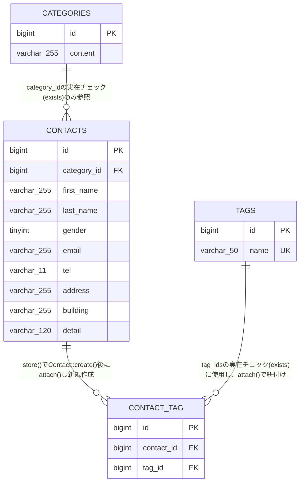

# Issue #3 設計書: お問い合わせ確認画面・送信処理(PG02)

## 1. 概要

POST `/contacts/confirm` で確認ページ(`contact.confirm`)を表示する処理(`ContactController@confirm`、`StoreContactRequest`によるバリデーション)はIssue #2で実装済みであり、本Issueでは変更しない。

本Issueで新たに実装するのは、確認ページの「送信」ボタンから呼ばれる POST `/contacts` の処理のみである。`routes/web.php` に `Route::post('/contacts', [ContactController::class, 'store'])` を追加し、`ContactController@store` で `StoreContactRequest` により再バリデーションしたうえで `Contact::create()` を行い、`tag_ids` が指定されていれば作成した `Contact` に `attach()` して `contact_tag` にも記録し、`/thanks` へリダイレクトする。

**本Issueのスコープに含まれないもの**:
- `/thanks` ページ自体の表示(GETルート・サンクスページの文言)はIssue #4の範囲であり、ここでは扱わない。本Issueでは `store()` の戻り先として `/thanks` へのリダイレクトのみを実装する。
- 確認ページ(`contact.confirm`)の表示処理・`StoreContactRequest` のバリデーションルール定義は[[02-contact-input]](Issue #2)で実装済みであり、本Issueでは変更しない。

## 2. 受け入れ条件(ACCEPTANCE.md 2章参照)

- 入力ページで全項目を入力し「確認画面」ボタンを押すと、入力内容(氏名・性別文字列・メール・電話・住所・建物名・カテゴリ名・タグ・内容)が確認ページに正しく表示される。
  - これはIssue #2で実装済みの`confirm()`により既に満たされている条件であり、本Issueでは回帰していないことをテストで再確認するのみとする。
- 確認ページで「送信」ボタンを押すと、`contacts`テーブルにレコードが作成され、タグがあれば`contact_tag`にも記録され、`/thanks`にリダイレクトされる。
  - 本Issueで新たに実装する`store()`の中心的な受け入れ条件。
- 確認ページで「修正」ボタンを押すと、入力内容が保持された状態で`/`に戻る。
  - `confirm.blade.php` の「修正」ボタンは `history.back()`(ブラウザの戻る)で実装済み・提供済みであり、バックエンドの変更を必要としない。本Issueでは実装・変更しない(Bladeの挙動として既に成立している)。

## 3. 変えないもの

- `resources/views/contact/index.blade.php`・`_form.blade.php`・`confirm.blade.php`・`thanks.blade.php` と `resources/js/contact/**`(提供済み。変更しない)
- `ContactController@index`・`ContactController@confirm`、`StoreContactRequest`のバリデーションルール・エラーメッセージ(Issue #2で実装済み。本Issueでは変更しない)
- `database/migrations/**`・`app/Models/Category.php`・`Tag.php`・`Contact.php`・`database/seeders/**`(Issue #1で実装済み。本Issueでは変更しない)
- `routes/api.php`・`config/sanctum.php` などSanctum関連ファイル(引き続き変更しない)
- `/thanks`のGETルート・サンクスページの表示内容(Issue #4の範囲であり、本Issueでは実装しない。本Issueは`store()`からのリダイレクト先として`/thanks`という文字列のみを使用する)

## 4. 増えるテーブル

なし。Issue #1で作成済みの`contacts`・`contact_tag`に対して、本Issueで初めて書き込み(`create()`・`attach()`)を行う。`categories`・`tags`は`confirm()`と同様に読み取り専用(`category_id`・`tag_ids`の実在確認のためのバリデーション参照)。

## 5. 増える画面

画面(View)自体の追加はなし。PG02(確認ページ)はIssue #2で表示済みであり、本Issueでは「送信」ボタンの送信先を実際に機能させるルーティング・コントローラーのみを追加する。

| 画面ID | 名称 | Method/Path | Controller | 備考 |
|---|---|---|---|---|
| PG02(送信) | お問い合わせフォーム確認ページ「送信」ボタン | POST `/contacts` | `ContactController@store` | `StoreContactRequest`で再バリデーション後、`Contact::create()`・タグ`attach()`・`/thanks`へリダイレクト(新規実装) |

参考: `confirm.blade.php`は提供済みBladeの時点で`<form action="/contacts" method="post">`と各項目のhiddenフィールドを備えており、本Issueはそのフォームの送信先を機能させるだけで、Blade側の変更は発生しない。

## 6. 入力チェックとメッセージ一覧

`store()`は`confirm()`と同じ`StoreContactRequest`を再利用して再バリデーションする(ルール・メッセージの変更なし)。再バリデーションが必要な理由は、確認ページのhiddenフィールドが開発者ツール等で改ざんされた状態のまま直接`POST /contacts`される可能性があるため。

| 項目 | ルール | エラーメッセージ |
|---|---|---|
| `first_name` | required, string, max:255 | 姓を入力してください |
| `last_name` | required, string, max:255 | 名を入力してください |
| `gender` | required, integer, in:1,2,3 | 性別を選択してください |
| `email` | required, string, email, max:255 | (required) メールアドレスを入力してください / (email) メールアドレスはメール形式で入力してください |
| `tel` | required, string, regex:`/^[0-9]{10,11}$/` | 電話番号を入力してください |
| `address` | required, string, max:255 | 住所を入力してください |
| `building` | nullable, string, max:255 | (エラーメッセージなし。任意項目) |
| `category_id` | required, integer, exists:categories,id | お問い合わせの種類を選択してください |
| `tag_ids` | nullable, array | (エラーメッセージなし。任意項目) |
| `tag_ids.*` | integer, exists:tags,id | 選択されたタグが存在しません |
| `detail` | required, string, max:120 | (required) お問い合わせ内容を入力してください / (max) お問い合わせ内容は120文字以内で入力してください |

**再バリデーションの失敗時の挙動に関する判断**: `store()`で`StoreContactRequest`のバリデーションに失敗した場合、Laravelの標準動作により直前のURL(`/contacts/confirm`、確認ページ)にエラーメッセージ付きでリダイレクトされる。確認ページを正規に経由していれば通常は失敗しないため、この経路は主に改ざんアクセスに対する防御であり、要件シート・ACCEPTANCE.mdにはこのケース専用の画面遷移先の定義はない。本設計ではLaravelの標準動作(直前のURLへリダイレクト)のままとし、独自のエラーページ遷移は実装しない。

日本語化は`StoreContactRequest::messages()`(Issue #2で実装済み)のまま使用し、本Issueでは追加・変更しない。

## 7. テスト観点

- すべての項目を正しく入力して(確認ページ経由を想定し)`POST /contacts`すると、`contacts`テーブルに1件のレコードが作成され、`/thanks`へリダイレクトされること(レスポンスの`Location`ヘッダーで確認)。
- `tag_ids`を1件以上指定して`POST /contacts`すると、作成された`Contact`に対応する`contact_tag`レコードが指定した件数分作成されること。
- `tag_ids`を指定せずに`POST /contacts`すると、`contacts`レコードは作成されるが`contact_tag`レコードは作成されないこと。
- 作成された`Contact`の`category()`リレーションが指定した`Category`を返し、`tags()`リレーションが指定した`Tag`のコレクションを返すこと。
- 必須項目(`first_name`/`last_name`/`gender`/`email`/`tel`/`address`/`category_id`/`detail`)のいずれかを欠いたまま直接`POST /contacts`した場合(確認ページを経由しない改ざんアクセスを想定)、バリデーションエラーになり`contacts`テーブルにレコードが作成されないこと。
- 存在しない`category_id`・存在しない`tag_ids.*`を指定して`POST /contacts`した場合、`exists`バリデーションでエラーになり`contacts`テーブルにレコードが作成されないこと。
- `building`を省略して`POST /contacts`しても、エラーにならず`contacts.building`が`NULL`で保存されること。
- `email`にメール形式でない文字列を指定して`POST /contacts`した場合、バリデーションエラーになり`contacts`テーブルにレコードが作成されないこと(確認ページ表示時の検証と同じ再利用ルールが`store()`でも機能していることの確認)。
- 同一の入力で複数回`POST /contacts`を実行すると、その都度`contacts`テーブルに新しいレコードが1件ずつ追加されること(二重送信防止の仕組みは要件になく、Issue #3の範囲では実装しないことの確認)。
