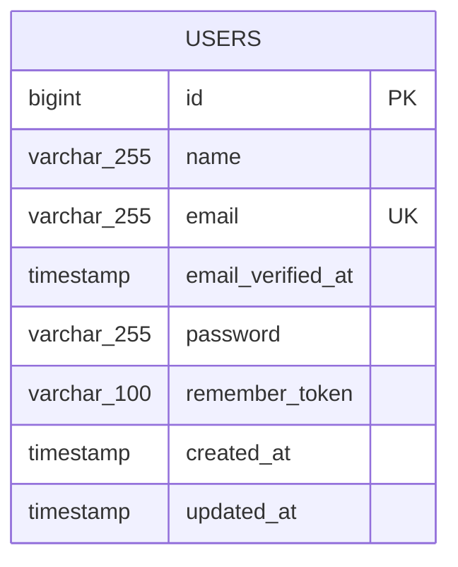

> この設計書は、この機能を実装した時点の記録です。このあとは更新していません。

# Issue #5 設計書: 管理者登録・ログイン・ログアウト(Fortify導入)

## 1. 概要

`laravel/fortify` を導入し、管理者登録(PG06 `/register`)・ログイン(PG05 `/login`)・ログアウト(`/logout`)を実装する。`resources/views/auth/register.blade.php`・`login.blade.php` は提供済みで変更しない。

- `composer require laravel/fortify` のうえ `sail artisan fortify:install` を実行し、`FortifyServiceProvider`・`config/fortify.php`・`app/Actions/Fortify/*` を生成する。
- `FortifyServiceProvider::boot()` で `Fortify::registerView`・`Fortify::loginView` を提供済みBladeにバインドする。
- `config/fortify.php` の `features` 配列は `Features::registration()` のみを有効にする(メール確認・パスワードリセット・2段階認証・プロフィール更新は要件にないため無効のまま)。ログイン・ログアウト自体はFortifyのコア機能として `features` の設定に関わらず常に有効。
- `CreateNewUser` アクションで登録時バリデーション(`name`/`email`/`password`/`password_confirmation`)を実装する。`CreateNewUser` はFormRequestを経由しないFortifyのアクションクラスのため、日本語化はIssue #2までの「FormRequestの`messages()`」方式ではなく `lang/ja/validation.php` のカスタムメッセージで行う([[../../CLAUDE.md]] の Assumptions の通り)。
- ログイン失敗時の「ログイン情報が登録されていません」、レート制限超過時のメッセージは `lang/ja/auth.php` のカスタムメッセージで日本語化する。
- ログインのレート制限は、Fortifyが内部で持つ`EnsureLoginIsNotThrottled`(5回/分、6回目でロック)をそのまま使う。`config/fortify.php`の`limiters.login`を`null`にする(スキャフォールド直後の既定値`'login'`のままだと、ルート側に`throttle:login`ミドルウェアが別途かかり、そちらが先に素の429レスポンス(日本語メッセージなし)を返してしまい、`EnsureLoginIsNotThrottled`によるセッションエラー+日本語メッセージの画面遷移に到達しないため)。この結果、`FortifyServiceProvider`に`fortify:install`が生成する`RateLimiter::for('login', ...)`の登録は不要になるため削除する。
- `/admin` を `auth` ミドルウェアで保護し、未認証アクセスは `/login` にリダイレクトする。この受け入れ条件を検証するには実在するルートが必要なため、本Issueで `AdminController@index` の最小実装(検索条件なしの一覧表示)を追加する。キーワード・性別・カテゴリ・日付による絞り込みはIssue #6の範囲であり、本Issueでは実装しない。

## 2. 受け入れ条件(ACCEPTANCE.md 4章・5章・6章・10章、0章一部参照)

- `/register` にアクセスすると、お名前・メールアドレス・パスワード・パスワード確認の入力フォームが表示される。
    - 提供済み `auth/register.blade.php` を `Fortify::registerView` でそのままバインドするだけで満たされる。
- 必要項目をすべて入力して「登録」ボタンを押すと、`users` テーブルに新しい管理者が作成され、`/admin` に遷移する。
- お名前・メールアドレス・パスワードの未入力、メール形式不正、8文字未満のパスワード、パスワード確認不一致のそれぞれで、要件シート記載の日本語エラーメッセージが表示される(詳細は「6. 入力チェックとメッセージ一覧」参照)。
- `/login` にアクセスすると、メールアドレス・パスワードの入力フォームが表示される。
    - 提供済み `auth/login.blade.php` を `Fortify::loginView` でそのままバインドするだけで満たされる。
- 登録済みの正しいメールアドレスとパスワードを入力して「ログイン」ボタンを押すと、`/admin` に遷移する。
- メールアドレス・パスワードが未入力の場合、それぞれ「メールアドレスを入力してください」「パスワードを入力してください」と表示される。
- 登録されていないメールアドレスやパスワードを入力すると「ログイン情報が登録されていません」と表示される。
- 同一アカウントに対して1分間に6回以上ログインに失敗すると、レート制限がかかりログインできなくなる。
- 画面右上の「login」「register」リンクで相互に遷移できる。
    - 提供済み `components/guest-layout.blade.php` に実装済みのリンクであり、本Issueでの変更は不要(動作確認のみ)。
- ログインせずに `/admin` に直接アクセスすると、`/login` にリダイレクトされる。
    - この条件を検証可能にするため、本Issueで `/admin` に認証必須の最小限の一覧表示を追加する(「5. 増える画面」参照)。検索・ページネーションの絞り込み条件(ACCEPTANCE.md 6章)はIssue #6の範囲であり、本Issueでは実装しない。
- ログイン済みの状態で `/admin` にアクセスすると、お問い合わせ一覧(お名前・性別・メールアドレス・お問い合わせの種類・タグ)が7件ごとにページネーション表示される(ACCEPTANCE.md 0章・6章の基本部分)。
    - 検索フォームの入力欄自体はBladeに既に存在するため表示はされるが、絞り込みロジック(キーワード・性別・カテゴリ・日付)はIssue #6で実装する。本Issueでは常に全件(新着順)を返す。
- 管理画面ヘッダーの「logout」ボタンを押すとセッションが破棄される(ACCEPTANCE.md 10章)。
    - Fortifyが標準で提供する `POST /logout` をそのまま使用し、本Issueでの追加実装は不要(動作確認のみ)。

## 3. 変えないもの

- `resources/views/auth/register.blade.php`・`login.blade.php`、`resources/views/components/guest-layout.blade.php`・`app-layout.blade.php`、`resources/views/admin/index.blade.php`(提供済み。変更しない)
- `resources/views/contact/**`・`resources/js/contact/**`、`ContactController`・`StoreContactRequest`(Issue #2〜#4で実装済み。本Issueでは変更しない)
- `database/migrations/**` のうち `users` テーブル定義(Issue #1で実装済み。カラムを追加しない)
- `routes/api.php`・`config/sanctum.php` などSanctum関連ファイル(引き続き変更しない)
- `AdminController@index` の検索条件(キーワード・性別・カテゴリ・日付によるフィルタリング)、`/admin/contacts/{contact}`・`/admin/tags/*` ルート(Issue #6〜#8の範囲であり、本Issueでは実装しない)

## 4. 増えるテーブル

なし。本Issueは Issue #1 で作成済みの `users` テーブルに対する認証ロジックのみを実装し、新規のマイグレーション・カラム追加は行わない。`fortify:install` 実行時に2段階認証用カラム(`two_factor_secret` 等)を追加するマイグレーションが生成される場合は、テーブル仕様書(DR05)に定義がなく要件にも含まれないため、削除し適用しない。

`USERS` の列構成はIssue #1から変更しない。他テーブルとの外部キー関係を持たないため、本Issueでも関係線の追加はない。

## 5. 増える画面

| 画面ID              | 名称                           | Method/Path     | Controller                                                   | 備考                                                                                 |
| ------------------- | ------------------------------ | ---------------- | -------------------------------------------------------------- | ------------------------------------------------------------------------------------ |
| PG06                 | 管理者登録画面                 | GET `/register`  | Fortify(`FortifyServiceProvider`経由で`auth.register`ビューを返す） | Blade提供済み。本Issueはビューのバインドのみ                                           |
| PG06(送信)           | 管理者登録画面「登録」ボタン    | POST `/register` | Fortify + `CreateNewUser`                                       | バリデーション通過時に`users`へ作成し`/admin`へリダイレクト(新規実装)                  |
| PG05                 | ログイン画面                   | GET `/login`     | Fortify(`auth.login`ビューを返す）                               | Blade提供済み。本Issueはビューのバインドのみ                                           |
| PG05(送信)           | ログイン画面「ログイン」ボタン  | POST `/login`    | Fortify                                                          | 認証成功時`/admin`へリダイレクト、失敗時エラーメッセージ・レート制限(新規実装/設定確認) |
| -                    | ログアウト                     | POST `/logout`   | Fortify                                                          | セッション破棄(Fortify標準。追加実装なし、動作確認のみ)                               |
| PG05(一覧・最小表示) | 管理画面(一覧)                 | GET `/admin`     | `AdminController@index`(新規)                                    | `auth`ミドルウェアで保護。検索条件なしで全件を7件ずつページネーション表示するのみ。検索・絞り込みはIssue #6で追加 |

## 6. 入力チェックとメッセージ一覧

### 管理者登録(`CreateNewUser`)

| 項目     | ルール                                                           | エラーメッセージ                                                                                 |
| -------- | ----------------------------------------------------------------- | --------------------------------------------------------------------------------------------- |
| name     | required, string, max:255                                         | お名前を入力してください                                                                       |
| email    | required, string, email, max:255, unique:users                    | (required) メールアドレスを入力してください / (email) メールアドレスはメール形式で入力してください |
| password | required, string, confirmed, Fortify標準の`Password::min(8)`      | (required) パスワードを入力してください / (min:8) パスワードは8文字以上で入力してください / (confirmed) パスワードと一致しません |

**要件シートに文言定義がなく本Issueで判断するもの**: `email`の`max:255`超過・`unique`違反(登録済みメールアドレス)、`name`の`max:255`超過は要件シート(機能要件一覧・バリデーションルール)に文言定義がない。Issue #2のお問い合わせフォーム側の判断(メールアドレスのmax超過時「メールアドレスは255文字以内で入力してください」)と表記を揃え、`email`は「メールアドレスは255文字以内で入力してください」(max)・「このメールアドレスは既に登録されています」(unique)、`name`は「お名前は255文字以内で入力してください」(max)とする。

日本語化は `lang/ja/validation.php` の `custom` 配列(`name`・`email`・`password` それぞれにルールごとのメッセージ)で行う。

### ログイン(Fortifyの`LoginRequest`)

| 項目         | ルール                | エラーメッセージ                                                                     |
| ------------ | --------------------- | ------------------------------------------------------------------------------------- |
| email        | required, string       | メールアドレスを入力してください                                                       |
| password     | required, string       | パスワードを入力してください                                                           |
| (認証失敗)   | -                       | ログイン情報が登録されていません                                                       |
| (レート制限) | 1分間に6回以上失敗      | 要件シートに文言定義なし。Fortify標準の`auth.throttle`を日本語化し「しばらくしてから再度お試しください」等を表示する |

`email`・`password`のrequiredメッセージは`lang/ja/validation.php`の`custom`配列、認証失敗・レート制限のメッセージは`lang/ja/auth.php`の`failed`・`throttle`キーで日本語化する。

## 7. テスト観点

- `GET /register`が200を返し、`auth.register`ビューが使われること。
- 全項目を正しく入力して`POST /register`すると、`users`テーブルにレコードが1件作成され(パスワードがハッシュ化されていること)、`/admin`へリダイレクトされること。
- `name`・`email`・`password`がそれぞれ未入力の場合に、要件シート記載の日本語エラーメッセージがセッションエラーとして返ること。
- メール形式でない`email`、8文字未満の`password`、`password`と`password_confirmation`が不一致の場合に、それぞれ要件シート記載の日本語エラーメッセージが返ること。
- 既に登録済みの`email`で`POST /register`すると、バリデーションエラーになり`users`テーブルにレコードが追加されないこと。
- `GET /login`が200を返し、`auth.login`ビューが使われること。
- 登録済みの正しいメールアドレス・パスワードで`POST /login`すると認証され、`/admin`へリダイレクトされること。
- `email`・`password`が未入力の場合に、それぞれ要件シート記載の日本語エラーメッセージが返ること。
- 登録されていない`email`・誤った`password`で`POST /login`すると「ログイン情報が登録されていません」というエラーメッセージが返り、認証されないこと。
- 同一アカウントに対して1分間に6回ログインを失敗させると、6回目(またはそれ以降)の試行がレート制限によって弾かれること。
- 未認証の状態で`GET /admin`にアクセスすると`/login`にリダイレクトされること。
- ログイン済みの状態で`GET /admin`にアクセスすると200が返り、Seederで投入した20件の`Contact`が7件ずつページネーション表示されること(1ページ目に7件表示)。
- ログイン済みの状態で`POST /logout`すると、セッションが破棄され、以後`GET /admin`にアクセスすると`/login`にリダイレクトされること。
