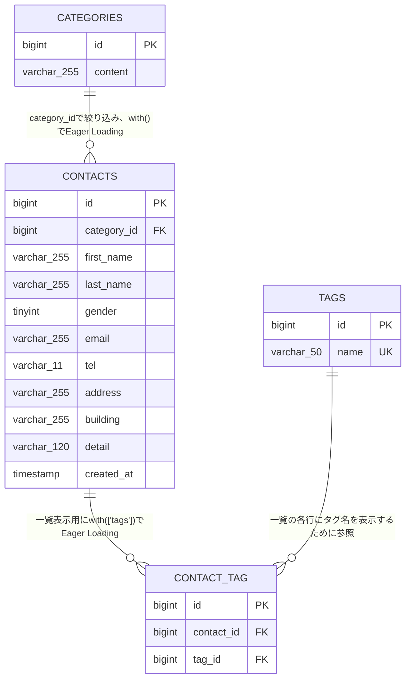

> この設計書は、この機能を実装した時点の記録です。このあとは更新していません。

# Issue #6 設計書: 管理画面 一覧・検索(PG05 `/admin`)

## 1. 概要

`GET /admin` の検索・絞り込み機能を実装する。`AdminController@index` はIssue #5で検索条件なしの最小実装(`Contact::with(['category', 'tags'])->latest()->paginate(7)`)として追加済みであり、本Issueはこの同じメソッドにクエリパラメータ(`keyword`/`gender`/`category_id`/`date`)による絞り込みを追加する(Issue #5→#6でメソッドを段階的に拡張する点は、Issue #2→#3の`confirm()`/`store()`の関係と同様)。

- `routes/web.php` の `GET /admin`(`auth`ミドルウェア配下、Issue #5で追加済み)は変更しない。
- クエリパラメータのバリデーションは `IndexContactRequest` で行う(`keyword`: nullable, string, max:255 / `gender`: nullable, integer, in:0,1,2,3(0=全て) / `category_id`: nullable, integer, exists:categories,id / `date`: nullable, date)。
- `keyword` は氏名(`first_name`・`last_name`)・メールアドレスへの部分一致(`orWhere` + `LIKE`)、`gender`・`category_id`・`date` は完全一致で絞り込み、複数条件は AND で組み合わせる。
- `category` ・ `tags` は引き続き `with()` でEager Loadingし、N+1を避ける(Issue #5で対応済みの方針を踏襲)。
- タグ管理セクション用の `tags` 一覧もビューに渡す(Issue #5で対応済み、変更なし)。

## 2. 受け入れ条件(ACCEPTANCE.md 6章参照)

- ログイン済みの状態で `/admin` にアクセスすると、お問い合わせ一覧(お名前・性別・メールアドレス・お問い合わせの種類・タグ)が7件ごとにページネーション表示される。
    - Issue #5で実装済みの基本表示がそのまま成立していることを確認する(本Issueで新たに壊していないことの回帰確認)。
- 名前の一部(部分一致)を検索欄に入力して「検索」ボタンを押すと、該当する名前のお問い合わせのみが一覧に表示される。
- メールアドレスを検索欄に入力して「検索」ボタンを押すと、該当するお問い合わせのみが一覧に表示される。
    - 検索欄(`name="keyword"`)は氏名・メールアドレス共通の1つの入力欄であり、`keyword`パラメータとして同じロジック(氏名・メールへの部分一致)で処理される。
- 性別のセレクトボックスで「男性」「女性」「その他」のいずれかを選択して「検索」ボタンを押すと、選択した性別のお問い合わせのみが一覧に表示される。
    - `gender`セレクトボックスの初期値・プレースホルダは`value="0"`(表示ラベル「性別」)であり、`gender=0`または未指定は「絞り込まない(全件)」として扱う。
- 「お問い合わせの種類」のセレクトボックスでカテゴリを選択して「検索」ボタンを押すと、選択したカテゴリのお問い合わせのみが一覧に表示される。
- 日付を指定して「検索」ボタンを押すと、その日付に作成されたお問い合わせのみが一覧に表示される。
    - `contacts.created_at`(日時)の日付部分が指定日と一致するものを対象とする(`whereDate`)。
- 名前・性別・カテゴリ・日付など複数の条件を同時に入力して「検索」ボタンを押すと、すべての条件に一致するお問い合わせのみが一覧に表示される。
- 検索結果が表示されている状態で「リセット」ボタンを押すと、検索条件がクリアされ、一覧が初期状態(全件・新着順)に戻る。
    - `admin/index.blade.php`の「リセット」は提供済みの`<a href="/admin">`リンクであり、クエリパラメータなしで`/admin`に戻るだけで満たされる。本Issueでの追加実装は不要(動作確認のみ)。
- 一覧の行にある「詳細」リンクを押すと、お問い合わせ詳細ページ(`/admin/contacts/{id}`)に遷移する。
    - `/admin/contacts/{contact}`(`AdminController@show`)はIssue #7の範囲であり、本Issueでは実装しない。現時点では該当リンクを押すと404になる。

## 3. 変えないもの

- `resources/views/admin/index.blade.php`・`components/app-layout.blade.php`(提供済み。変更しない)
- `routes/web.php` の `GET /admin` ルート定義・`auth`ミドルウェアによる保護(Issue #5で実装済み)
- `AdminController@index` のEager Loading方針(`with(['category', 'tags'])`)・`paginate(7)`(Issue #5で実装済み、本Issueはこれに検索条件を追加するのみ)
- `database/migrations/**`・モデル・`database/seeders/**`(Issue #1で実装済み。新規カラム・新規テーブルの追加はなし)
- `/admin/contacts/{contact}`(詳細ページ、`AdminController@show`)・`/admin/tags/*`(タグ管理CRUD)(Issue #7・#8の範囲であり、本Issueでは実装しない)
- Fortify関連(`app/Actions/Fortify/**`・`FortifyServiceProvider`・`config/fortify.php`)・`routes/api.php`(引き続き変更しない)

## 4. 増えるテーブル

なし。本Issueは Issue #1 で作成済みの `contacts`・`categories`・`tags`・`contact_tag` を検索条件付きで読み取るのみで、新規のマイグレーション・カラム追加は行わない。

`first_name`・`last_name`・`email`は`keyword`の部分一致検索に、`gender`は完全一致検索に、`created_at`は`date`検索に使用する。テーブル構成自体はIssue #1から変更しない。

## 5. 増える画面

| 画面ID    | 名称                       | Method/Path        | Controller                         | 備考                                                                                                   |
| --------- | -------------------------- | ------------------- | ------------------------------------ | ------------------------------------------------------------------------------------------------------ |
| PG05(検索) | 管理画面(一覧・検索)       | GET `/admin` + query | `AdminController@index`(拡張)        | `IndexContactRequest`で`keyword`/`gender`/`category_id`/`date`をバリデーションし、絞り込んだ一覧を7件ずつページネーション表示(Issue #5の最小実装を拡張) |
| -         | 検索結果のリセット          | GET `/admin`         | `AdminController@index`(パラメータなし) | 提供済み`<a href="/admin">`リンクで実現。新規実装なし                                                   |

## 6. 入力チェックとメッセージ一覧

| 項目          | ルール                                   | エラーメッセージ |
| ------------- | ----------------------------------------- | ---------------- |
| `keyword`     | nullable, string, max:255                 | (下記参照)        |
| `gender`      | nullable, integer, in:0,1,2,3(0=全て)     | (下記参照)        |
| `category_id` | nullable, integer, exists:categories,id   | (下記参照)        |
| `date`        | nullable, date                            | (下記参照)        |

**要件シートに文言定義がなく本Issueで判断するもの**: バリデーションルール表(要件シート)はこの画面の各項目にルールのみを定義しており、エラーメッセージの文言・表示先は定義していない。また `admin/index.blade.php` の検索フォーム部分(`keyword`/`gender`/`category_id`/`date`の各入力欄)には`@error`等のエラー表示用マークアップが存在しない(タグ追加フォームの`name`フィールドのみ`@error('name')`を持つ)。

検索条件は`gender`・`category_id`がセレクトボックス、`date`がHTML5の`<input type="date">`であり、通常のブラウザ操作では不正な値を入力できない構造になっている(不正な値が送られるのはURL直接操作などの改ざんアクセスのみ)。したがって本Issueでは、`IndexContactRequest`のバリデーションに失敗した場合はエラーメッセージを画面に表示せず、`/admin`(パラメータなし・初期状態)へリダイレクトする(「リセット」と同じ着地点になる)という挙動にする。日本語のエラーメッセージ文言自体は使用しないが、CLAUDE.mdのAssumptionsに従い、万一エラーバッグを参照するコードが残っても英語メッセージが露出しないよう、`IndexContactRequest::messages()`は日本語の文言を一応定義しておく(`keyword`:「キーワードは255文字以内で入力してください」、`gender`:「性別の値が不正です」、`category_id`:「選択されたカテゴリが存在しません」、`date`:「日付の形式が正しくありません」。これらはAPI版(Issue #10、`IndexContactRequest`とは別クラス)のエラーメッセージ文言(要件シートAPI仕様書記載)と表記を揃える)。

## 7. テスト観点

- 未認証の状態で`GET /admin`にアクセスすると`/login`にリダイレクトされること(Issue #5のリグレッション確認)。
- ログイン済みの状態で`GET /admin`にアクセスすると200が返り、20件のSeeder投入済み`Contact`が7件ずつページネーション表示されること(Issue #5のリグレッション確認)。
- `keyword`に氏名の一部を指定すると、`first_name`または`last_name`が部分一致する`Contact`のみが返ること。
- `keyword`にメールアドレスの一部を指定すると、`email`が部分一致する`Contact`のみが返ること。
- `keyword`がどの`first_name`/`last_name`/`email`にも一致しない場合、結果が0件になること。
- `gender`に1・2・3を指定すると、その性別の`Contact`のみが返ること。
- `gender=0`または`gender`未指定の場合、性別による絞り込みが行われず全件が対象になること。
- `category_id`に実在するIDを指定すると、そのカテゴリの`Contact`のみが返ること。
- `date`に特定の日付を指定すると、その日に作成された`Contact`のみが返ること(日をまたぐ`created_at`は対象外)。
- `keyword`・`gender`・`category_id`・`date`を複数同時に指定すると、すべての条件に一致する`Contact`のみが返ること(AND条件)。
- 不正な`gender`(例: 9)を指定して`GET /admin`にアクセスすると、絞り込みが適用されずに`/admin`(初期状態)へリダイレクトされること。
- 存在しない`category_id`を指定した場合も同様に`/admin`へリダイレクトされること。
- 不正な形式の`date`を指定した場合も同様に`/admin`へリダイレクトされること。
- 検索結果が表示されている状態で「リセット」リンク(`href="/admin"`)を押すと、クエリパラメータなしの`/admin`に遷移し、全件・新着順の初期状態に戻ること。
- 一覧取得時に`category`・`tags`がEager Loadingされており、表示件数に関わらずクエリ数が一定であること(N+1が発生していないこと)。
- `GET /admin`のレスポンスに`categories`・`tags`がビュー変数として渡され、検索フォームの選択肢・タグ管理セクションに使用されること(Issue #5のリグレッション確認)。
