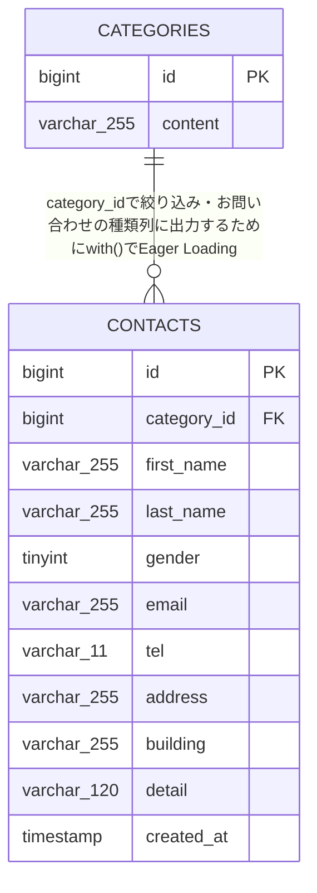

> この設計書は、この機能を実装した時点の記録です。このあとは更新していません。

# Issue #9 設計書: CSVエクスポート機能

## 1. 概要

`GET /contacts/export` で、検索条件に一致するお問い合わせをBOM付きCSVとしてダウンロードする機能を実装する。URLは`/contacts/*`配下だが、管理画面からのみ利用する機能であるため`auth`ミドルウェアで保護する(Issue本文の指定通り)。

- `routes/web.php` の `GET /contacts/export` は `ContactController@export`(`auth`配下)とする。公開フォーム用の`ContactController@index`等と同じコントローラーに実装する点はIssue本文の指定に従う(URLのパス階層が`/contacts/*`であるため)。
- クエリパラメータ(`keyword`/`gender`/`category_id`/`date`)のバリデーションは`ExportContactRequest`で行い、ルール・日本語メッセージはIssue #6の`IndexContactRequest`と同一内容にする(要件シートで「`/admin`の検索と同じバリデーションルール」と明記されているため)。
- 絞り込みロジックも`AdminController::index()`の`when()`チェーンと同じ条件(`keyword`は氏名・メールへの部分一致、`gender`は`0`で絞り込まない、`category_id`・`date`は完全一致)を用いる。フィルタ未指定時は全件を新着順で取得する。
- 出力列はID/氏名(姓+名)/性別(文字列)/メールアドレス/電話番号/住所/建物名/お問い合わせの種類(カテゴリ名の文字列)/内容/作成日の10列(タグは出力列に含まれない。要件シート・ACCEPTANCE.mdのヘッダー列挙にタグが含まれていないため)。
- `response()->streamDownload()`でBOM(`\xEF\xBB\xBF`)を先頭に付けたCSVをストリーミングダウンロードし、1行目にヘッダー行を出力する。

## 2. 受け入れ条件(ACCEPTANCE.md 7章参照)

- `/admin` で検索条件を指定せずに「エクスポート」ボタンを押すと、全件が新着順でBOM付きCSVとしてダウンロードされる。
- `/admin` で検索条件(キーワード・性別・カテゴリ・日付)を指定してから「エクスポート」ボタンを押すと、その検索条件に一致するお問い合わせのみがCSVとしてダウンロードされる。
    - `admin/index.blade.php`の「エクスポート」リンクは`href="/contacts/export?{{ http_build_query(request()->query()) }}"`(提供済み・変更不可)であり、`/admin`の検索条件(クエリパラメータ)をそのまま`/contacts/export`に引き継ぐ。本Issueは`/contacts/export`側の処理のみを実装し、リンクの引き継ぎ自体はBladeの実装済みの挙動に乗る。
- ダウンロードしたCSVをExcelやテキストエディタで開くと、1行目にヘッダー行(ID/氏名/性別/メールアドレス/電話番号/住所/建物名/お問い合わせの種類/内容/作成日)があり、文字化けせずに日本語が表示される。
    - Excelでの文字化け回避のため、CSV本体の先頭にUTF-8のBOM(`\xEF\xBB\xBF`)を付与する。

本Issueの受け入れ条件には明記されていないが、Issue本文で`auth`配下と指定されているため、未ログインで`/contacts/export`に直接アクセスすると`/login`にリダイレクトされることも合わせて満たすべき条件として扱う。

## 3. 変えないもの

- `resources/views/admin/index.blade.php`(「エクスポート」リンクのマークアップ含む。提供済み、変更しない)
- `AdminController::index()`・`IndexContactRequest`(Issue #6で実装済み。検索ロジックの参照元として踏襲するのみで、変更はしない)
- `ContactController`の既存メソッド(`index`・`confirm`・`store`・`thanks`、Issue #2〜#4で実装済み。本Issueでは`export`メソッドを追加するのみ)
- `database/migrations/**`・モデル・`database/seeders/**`(Issue #1で実装済み。新規カラム・新規テーブルの追加はなし)
- `TagController`・`/admin/tags/*`(Issue #8の範囲。変更しない)
- `/admin/contacts/{contact}`(Issue #7の範囲。変更しない)

## 4. 増えるテーブル

なし。本Issueは Issue #1 で作成済みの `contacts`・`categories` を検索条件付きで読み取り、CSVとして出力するのみで、新規のマイグレーション・カラム追加は行わない(`tags`・`contact_tag`はCSV出力列に含まれないため参照しない)。

`first_name`・`last_name`・`gender`・`email`・`tel`・`address`・`building`・`detail`・`created_at`をCSVの各列にそのまま(または文字列変換して)出力する。`tags`・`contact_tag`はCSV出力列に含まれないため、本Issueの範囲では参照しない。テーブル構成自体はIssue #1から変更しない。

## 5. 増える画面

画面(View)の追加はなし。「エクスポート」ボタン自体は`admin/index.blade.php`(Issue #6で提供・実装済み)にあり、本Issueはその遷移先である`/contacts/export`からのCSVファイルダウンロード処理のみを追加する。

| 画面ID | 名称 | Method/Path | Controller | 備考 |
| --- | --- | --- | --- | --- |
| - | CSVダウンロード | GET `/contacts/export` + query | `ContactController@export`(新規) | `ExportContactRequest`で検索条件を検証し、BOM付きCSVをストリーミングダウンロード。画面(HTML)は返さない |

## 6. 入力チェックとメッセージ一覧

| 項目 | ルール | エラーメッセージ |
| --- | --- | --- |
| `keyword` | nullable, string, max:255 | (下記参照) |
| `gender` | nullable, integer, in:0,1,2,3(0=全て) | (下記参照) |
| `category_id` | nullable, integer, exists:categories,id | (下記参照) |
| `date` | nullable, date | (下記参照) |

要件シートの指定通り、`IndexContactRequest`(Issue #6)と同一のルール・日本語メッセージ(`keyword.max`:「キーワードは255文字以内で入力してください」、`gender.integer`/`gender.in`:「性別の値が不正です」、`category_id.integer`/`category_id.exists`:「選択されたカテゴリが存在しません」、`date.date`:「日付の形式が正しくありません」)を`ExportContactRequest`にも用いる。

**バリデーション失敗時の挙動**: 「エクスポート」リンクはCSVファイルのダウンロードを直接引き起こすものであり、エラーメッセージを表示する画面を持たない(`IndexContactRequest`と同様、エラー表示用のBladeマークアップが存在しない)。したがって`IndexContactRequest`の判断を踏襲し、バリデーションに失敗した場合はエラーメッセージを表示せず`/admin`(初期状態)へリダイレクトする。通常の「エクスポート」リンクのクリックでは`/admin`側で既に検証済みの値がそのまま引き継がれるため、この経路は主にURLの直接改ざんアクセスに対する防御である。

## 7. テスト観点

- 未認証の状態で`GET /contacts/export`にアクセスすると`/login`にリダイレクトされること。
- ログイン済みの状態で検索条件を指定せずに`GET /contacts/export`すると、200が返り、`Content-Type`が`text/csv`相当であること。
- 検索条件を指定せずにエクスポートすると、Seederで投入した全件(20件)が新着順(`created_at`降順)でCSVに含まれること。
- `keyword`・`gender`・`category_id`・`date`をそれぞれ指定してエクスポートすると、`AdminController::index()`の検索と同じ条件でレコードが絞り込まれ、該当する行のみCSVに含まれること(複数条件の組み合わせも含む)。
- CSVの1行目がヘッダー行(`ID,氏名,性別,メールアドレス,電話番号,住所,建物名,お問い合わせの種類,内容,作成日`)であること。
- CSVの本文がBOM(`\xEF\xBB\xBF`)から始まること。
- 各データ行で、氏名が姓+名の結合、性別が文字列(男性/女性/その他)、お問い合わせの種類がカテゴリ名の文字列に変換されて出力されていること。
- 不正な`gender`(例: 9)・存在しない`category_id`・不正な形式の`date`を指定して`GET /contacts/export`にアクセスすると、CSVダウンロードされずに`/admin`へリダイレクトされること。
- CSVの列にタグ(`tags`)が含まれていないこと(要件シート・ACCEPTANCE.mdのヘッダー列挙に合わせた出力列になっていることの確認)。
