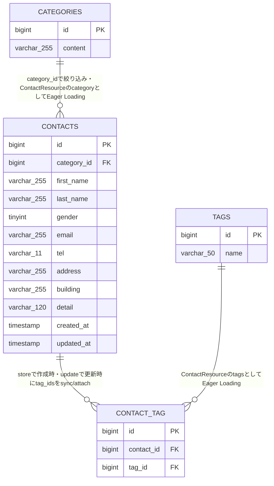

> この設計書は、この機能を実装した時点の記録です。このあとは更新していません。

# Issue #10 設計書: 公開API `/api/v1/contacts`

## 1. 概要

要件シート「API仕様書」に基づき、認証・認可不要の公開REST API(`/api/v1/contacts`)を実装する(`laravel/sanctum`は導入済みだが本Issueでは使用しない)。Web版(`/`・`/admin`配下)とはコントローラー・FormRequestを完全に分離し、同じ`contacts`テーブルに対して別経路でアクセスできるようにする。

- `routes/api.php` に以下の5ルートを定義する(`RouteServiceProvider`により自動で`/api`プレフィックス・`api`ミドルウェアグループが付与されるため、ミドルウェア追加は不要)。

    | Method | URI | Action |
    | --- | --- | --- |
    | GET | `/api/v1/contacts` | `index`(一覧+検索+ページング) |
    | GET | `/api/v1/contacts/{contact}` | `show`(詳細) |
    | POST | `/api/v1/contacts` | `store`(作成) |
    | PUT | `/api/v1/contacts/{contact}` | `update`(更新) |
    | DELETE | `/api/v1/contacts/{contact}` | `destroy`(削除) |

- `App\Http\Controllers\Api\V1\ContactController`を新設する(Web版の`App\Http\Controllers\ContactController`とは別クラス)。`{contact}`は暗黙のルートモデル結合(`Contact $contact`)を使い、存在しないIDは`ModelNotFoundException`を発生させる。
- バリデーションは`App\Http\Requests\Api\V1\IndexContactRequest`・`StoreContactRequest`・`UpdateContactRequest`を新設する(Web版の同名クラスとは別クラス・別名前空間)。ルールの型自体はWeb版(`IndexContactRequest`・`StoreContactRequest`)を踏襲しつつ、エラーメッセージの一部をIssue本文の指定(電話番号形式・性別不正・カテゴリ不存在・タグ不存在)に合わせて上書きする。
- `UpdateContactRequest`のルールは`StoreContactRequest`と同一とする(PUTは全項目を送る完全上書き更新として扱う。PATCHの部分更新は本Issueの対象外)。
- バリデーション失敗時は、ブラウザのアドレスバー直打ち(`Accept: text/html`)でも必ずJSONの422エラーが返るようにする必要がある。デフォルトの`FormRequest::failedValidation()`は`Accept`ヘッダーで分岐してリダイレクトしてしまうため、3つのFormRequestすべてで`failedValidation()`をオーバーライドし、常に`response()->json(['errors' => $validator->errors()], 422)`を`HttpResponseException`で投げるようにする。
- `App\Http\Resources\ContactResource`・`CategoryResource`・`TagResource`を新設し、レスポンスをラップする。`ContactResource`は`category`(`CategoryResource`)・`tags`(`TagResource`のコレクション)を含む。
- 一覧は`Contact::with(['category', 'tags'])->filter($request)->latest()->paginate($perPage)`で取得する(`Contact::scopeFilter()`はIssue #6で実装済みのものをそのまま利用。`keyword`/`gender`/`category_id`/`date`の絞り込みロジックはWeb版と共通)。`$perPage`は`per_page`クエリ(未指定時15、`min:1`/`max:100`)。レスポンスは`data`(`ContactResource`のコレクション)+`meta`(`current_page`/`last_page`/`per_page`/`total`)。
- `gender`はAPIでは「指定したら必ず絞り込む」仕様とする(Web版の管理画面検索にある「0=すべて」という特別値は持たない)。絞り込まない場合は`gender`パラメータ自体を省略する。
- 存在しないIDへのアクセス(`show`/`update`/`destroy`)は`ModelNotFoundException`→`NotFoundHttpException`となるが、デフォルトのHTML/Laravel標準JSON(`{"message": "..."}`)ではなく、Issue指定の`{"error": "お問い合わせが見つかりませんでした。"}`を返す必要がある。`app/Exceptions/Handler.php::render()`で、リクエストが`api/*`配下のときに限り`ModelNotFoundException`(`NotFoundHttpException`に変換される前の元の例外)を捕捉してカスタムJSONを返すよう分岐を追加する(`api/*`限定にすることで、Web版`/admin/contacts/{contact}`の404挙動(標準の404ページ)には影響させない)。
- 作成成功201・更新成功200・削除成功204・バリデーションエラー422・404エラーとする。

## 2. 受け入れ条件(ACCEPTANCE.md 11章参照)

- `GET /api/v1/contacts`で`data`+`meta`(`current_page`/`last_page`/`per_page`/`total`)付きJSONが200で返る。
- `keyword`(姓・名・メールいずれかに部分一致)・`gender`・`category_id`・`per_page`で絞り込み・ページングできる。
- 不正な`gender`(例: `9`)を渡すと422で「性別の値が不正です」が返る。
- 存在しない`category_id`(例: `9999`)を渡すと422で「選択されたカテゴリが存在しません」が返る。
- `GET /api/v1/contacts/{id}`で詳細(`category`・`tags`含む)が200で返り、存在しないID(例: `999999`)は404で「お問い合わせが見つかりませんでした。」が返る。
- `POST /api/v1/contacts`に必須項目をすべて含めると201で作成後のJSONが返り、`contacts`テーブルに新規レコードが作成される。
- `POST /api/v1/contacts`で必須項目(氏名・性別・メール・電話番号・住所・カテゴリID・内容)を欠くと422で日本語バリデーションメッセージが返る。
- `POST /api/v1/contacts`で10桁未満・12桁以上の電話番号を含めると422で「電話番号はハイフンなしの10〜11桁で入力してください」が返る。
- `POST /api/v1/contacts`で存在しない`category_id`を含めると422で「選択されたカテゴリが存在しません」が返る。
- `POST /api/v1/contacts`で存在しない`tag_ids`を含めると422で「選択されたタグが存在しません」が返る。
- `PUT /api/v1/contacts/{id}`に実在するIDで更新内容を送ると200で更新後のJSONが返り、`contacts`テーブルの該当レコードが更新される。存在しないIDへのPUTは404。
- `DELETE /api/v1/contacts/{id}`に実在するIDで送ると204が返り、`contacts`テーブルから削除される。存在しないIDへのDELETEは404。

## 3. 変えないもの

- `resources/views/**`(提供済みBlade。本Issueはビューを一切返さないAPIのみの追加であり、画面は増えない)
- `routes/web.php`・Web版の`App\Http\Controllers\ContactController`・`AdminController`・`TagController`とそれぞれのFormRequest(`App\Http\Requests\{Index,Store}ContactRequest`等。Issue #2〜#9で実装済み。本IssueではAPI版を別クラスとして追加するのみで、Web版のクラス・ルール・メッセージは一切変更しない)
- `database/migrations/**`・`app/Models/Contact.php`・`Category.php`・`Tag.php`・`database/seeders/**`(Issue #1で実装済み。本Issueは既存の`contacts`・`categories`・`tags`・`contact_tag`を読み書きするのみで、新規カラム・新規テーブルの追加はなし。`Contact::scopeFilter()`もIssue #6のものをそのまま利用する)
- `app/Exceptions/Handler.php`の既存の`register()`・`$dontFlash`(本Issueでは`render()`メソッドを新設するのみで、既存のメソッド・プロパティは変更しない)
- `routes/api.php`の既存の`/api/user`(Sanctum雛形。削除せず残す)

## 4. 増えるテーブル

なし。本Issueは Issue #1 で作成済みの `contacts`・`categories`・`tags`・`contact_tag` をAPI経由で読み書きするのみで、新規のマイグレーション・カラム追加は行わない。

テーブル構成自体はIssue #1から変更しない。`store`時は`tag_ids`が指定されていればその`Tag`群を`attach()`し、`update`時は送られてきた`tag_ids`(未指定時は空配列として扱う)で`sync()`する(PUTを全項目の完全上書きとして扱う方針に合わせ、送らなかったタグは解除される)。

## 5. 増える画面

画面(View)の追加はなし。本Issueは`/api/v1/*`配下のJSON APIのみを追加する。

| 画面ID | 名称 | Method/Path | Controller | 備考 |
| --- | --- | --- | --- | --- |
| - | お問い合わせ一覧API | GET `/api/v1/contacts` | `Api\V1\ContactController@index`(新規) | `IndexContactRequest`で検証し、`data`+`meta`のJSONを返す |
| - | お問い合わせ詳細API | GET `/api/v1/contacts/{contact}` | `Api\V1\ContactController@show`(新規) | `category`・`tags`を含むJSONを返す。存在しないIDは404 JSON |
| - | お問い合わせ作成API | POST `/api/v1/contacts` | `Api\V1\ContactController@store`(新規) | `StoreContactRequest`で検証し、201でJSONを返す |
| - | お問い合わせ更新API | PUT `/api/v1/contacts/{contact}` | `Api\V1\ContactController@update`(新規) | `UpdateContactRequest`で検証し、200でJSONを返す。存在しないIDは404 JSON |
| - | お問い合わせ削除API | DELETE `/api/v1/contacts/{contact}` | `Api\V1\ContactController@destroy`(新規) | 204を返す(ボディなし)。存在しないIDは404 JSON |

## 6. 入力チェックとメッセージ一覧

### `Api\V1\IndexContactRequest`(クエリパラメータ)

| 項目 | ルール | エラーメッセージ |
| --- | --- | --- |
| `keyword` | nullable, string, max:255 | `keyword.max`: 「キーワードは255文字以内で入力してください」 |
| `gender` | nullable, integer, in:1,2,3 | `gender.integer`/`gender.in`: 「性別の値が不正です」 |
| `category_id` | nullable, integer, exists:categories,id | `category_id.integer`/`category_id.exists`: 「選択されたカテゴリが存在しません」 |
| `date` | nullable, date | `date.date`: 「日付の形式が正しくありません」 |
| `per_page` | nullable, integer, min:1, max:100 | `per_page.integer`/`per_page.min`/`per_page.max`: 「1ページあたりの件数は1〜100の範囲で指定してください」 |

`page`はLaravelの標準ページネーション機構が解釈するパラメータであり、本FormRequestのバリデーション対象には含めない(不正な値(文字列等)が来た場合はLaravel標準の挙動(1ページ目扱い)に委ねる)。

### `Api\V1\StoreContactRequest`・`Api\V1\UpdateContactRequest`(リクエストボディ、ルール・メッセージは共通)

| 項目 | ルール | エラーメッセージ |
| --- | --- | --- |
| `first_name` | required, string, max:255 | `required`: 「姓を入力してください」/ `string`: 「姓は文字列で入力してください」/ `max`: 「姓は255文字以内で入力してください」 |
| `last_name` | required, string, max:255 | `required`: 「名を入力してください」/ `string`: 「名は文字列で入力してください」/ `max`: 「名は255文字以内で入力してください」 |
| `gender` | required, integer, in:1,2,3 | `required`/`integer`/`in`: 「性別の値が不正です」 |
| `email` | required, string, email, max:255 | `required`: 「メールアドレスを入力してください」/ `string`・`email`: 「メールアドレスはメール形式で入力してください」/ `max`: 「メールアドレスは255文字以内で入力してください」 |
| `tel` | required, string, regex:/^[0-9]{10,11}$/ | `required`/`string`/`regex`: 「電話番号はハイフンなしの10〜11桁で入力してください」 |
| `address` | required, string, max:255 | `required`: 「住所を入力してください」/ `string`: 「住所は文字列で入力してください」/ `max`: 「住所は255文字以内で入力してください」 |
| `building` | nullable, string, max:255 | `string`: 「建物名は文字列で入力してください」/ `max`: 「建物名は255文字以内で入力してください」 |
| `category_id` | required, integer, exists:categories,id | `required`/`integer`: 「お問い合わせの種類を選択してください」/ `exists`: 「選択されたカテゴリが存在しません」 |
| `tag_ids` | nullable, array | `array`: 「タグの指定が正しくありません」 |
| `tag_ids.*` | integer, exists:tags,id, distinct | `integer`/`distinct`: 「タグの指定が正しくありません」/ `exists`: 「選択されたタグが存在しません」 |
| `detail` | required, string, max:120 | `required`: 「お問い合わせ内容を入力してください」/ `string`: 「お問い合わせ内容は文字列で入力してください」/ `max`: 「お問い合わせ内容は120文字以内で入力してください」 |

`gender`・`category_id.exists`・`tel.regex`はIssue本文で明示された文言(Web版の同名フィールドのメッセージとは異なる)。それ以外のフィールドはWeb版`StoreContactRequest`と同じ文言を用いる(ACCEPTANCE.mdが文言まで指定していないため)。

**バリデーション失敗時の挙動**: 3つのFormRequestすべてで`failedValidation()`をオーバーライドし、`Accept`ヘッダーに関わらず常に`response()->json(['errors' => $validator->errors()], 422)`を返す(ブラウザのアドレスバー直打ちで`GET /api/v1/contacts?gender=9`のようにアクセスした場合でも、デフォルトの`FormRequest`の分岐(`expectsJson()`でリダイレクトされる)を避けるため)。

## 7. テスト観点

- `GET /api/v1/contacts`が200で、`data`配列と`meta`(`current_page`/`last_page`/`per_page`/`total`)を含むJSON構造で返ること。
- `keyword`指定時、姓・名・メールアドレスのいずれかに部分一致するお問い合わせのみ`data`に含まれること。
- `gender`指定時、その性別のお問い合わせのみ`data`に含まれること。
- `category_id`指定時、そのカテゴリのお問い合わせのみ`data`に含まれること。
- `per_page`指定時、1ページあたりの件数がその値になること(未指定時は15件になること)。
- 不正な`gender`(例: `9`)で422になり、レスポンスJSONに「性別の値が不正です」が含まれること。
- 存在しない`category_id`(例: `9999`)で422になり、レスポンスJSONに「選択されたカテゴリが存在しません」が含まれること。
- `GET /api/v1/contacts/{id}`が200で返り、レスポンスに`category`(カテゴリ名)・`tags`(タグ名の配列)が含まれること。
- `GET /api/v1/contacts/999999`が404になり、レスポンスJSONが`{"error": "お問い合わせが見つかりませんでした。"}`であること。
- 必須項目をすべて含めて`POST /api/v1/contacts`すると201が返り、`contacts`テーブルに新規レコードが`assertDatabaseHas`で確認できること。
- 必須項目(氏名・性別・メール・電話番号・住所・カテゴリID・内容)を欠いて`POST`すると422になり、各フィールドの日本語メッセージが返ること。
- 10桁未満・12桁以上の電話番号で`POST`すると422になり、「電話番号はハイフンなしの10〜11桁で入力してください」が返ること。
- 存在しない`category_id`で`POST`すると422になり、「選択されたカテゴリが存在しません」が返ること。
- 存在しない`tag_ids`を含めて`POST`すると422になり、「選択されたタグが存在しません」が返ること。
- `tag_ids`を含めて`POST`すると、作成されたお問い合わせに指定したタグが紐づくこと(`contact_tag`に`assertDatabaseHas`)。
- `PUT /api/v1/contacts/{id}`に実在するIDで更新内容を送ると200が返り、`contacts`テーブルの該当レコードが更新されること(`assertDatabaseHas`)。
- `PUT`で`tag_ids`を送ると、更新前に紐づいていたタグが送った`tag_ids`の内容に`sync()`されること(送らなかった既存タグが解除されることを含む)。
- `PUT /api/v1/contacts/999999`が404になり、レスポンスJSONが`{"error": "お問い合わせが見つかりませんでした。"}`であること。
- `DELETE /api/v1/contacts/{id}`に実在するIDで送ると204が返り(レスポンスボディが空であること含む)、`contacts`テーブルから該当レコードが`assertDatabaseMissing`で確認できること。
- `DELETE`で削除したお問い合わせに紐づいていた`contact_tag`も削除されること(Issue #1のON DELETE CASCADEの確認)。
- `DELETE /api/v1/contacts/999999`が404になり、レスポンスJSONが`{"error": "お問い合わせが見つかりませんでした。"}`であること。
- `/api/v1/*`への全リクエストで`Accept: text/html`(ブラウザ直打ち相当)でも常にJSONレスポンスが返ること(バリデーションエラー・404エラーを含む)。
- Web版`/admin/contacts/{contact}`(存在しないID)の404挙動が本Issueの変更によって影響を受けていないこと(標準の404のまま)。
